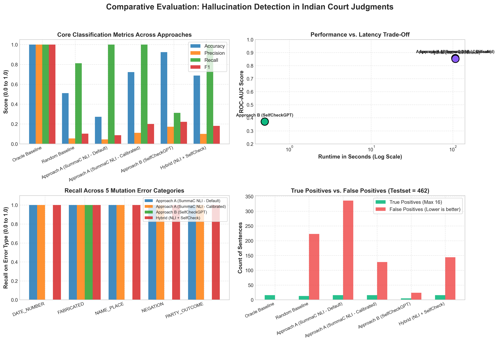

# ⚖️ Detecting Hallucinations in AI-Generated Legal Text

[](https://www.python.org/)
[](https://pytorch.org/)
[](https://huggingface.co/)
[](https://streamlit.io/)
[]()
[](https://github.com/Law-AI/MILDSum)

> A modular NLP research framework and interactive platform to detect and flag factual hallucinations in AI-generated summaries of Indian Court Judgments using **Cross-Encoder NLI (SummaC)** and **LLM Self-Consistency Checking (SelfCheckGPT)**.

---

## 📌 Problem & Motivation

Large Language Models (LLMs) frequently generate **hallucinations**—statements that sound fluent and authoritative but contradict or fabricate key facts. In legal summarization, a single inverted verdict, altered monetary figure, or swapped party name can lead to severe legal and financial consequences.

This project evaluates sentence-level hallucination detection on **Indian High Court judgments** across two complementary paradigms:
1. **Approach A (NLI-Based / White-Box):** Pairwise cross-encoder checking between judgment chunks and summary sentences using `microsoft/deberta-base-mnli` via **SummaC**.
2. **Approach B (Self-Consistency / Black-Box):** Zero-resource multi-sample consistency scoring using open LLMs via **SelfCheckGPT**.
3. **Hybrid Ensemble:** Domain-calibrated fusion combining fine-grained logical verification with stochastic consensus.

---

## 🚀 Final Comparative Benchmark Results

Evaluated on the **MILDSum Legal Benchmark** (462 sentences, 10 Indian court judgments, 5 mutation error types):

| Model / Approach | Decision Threshold ($\theta$) | Accuracy | Precision | Recall | F1 Score | ROC-AUC | Runtime | Key Advantage |
| :--- | :---: | :---: | :---: | :---: | :---: | :---: | :---: | :--- |
| **Oracle Baseline** | 0.50 | 100.0% | 100.0% | 100.0% | 1.0000 | 1.0000 | <0.01s | Theoretical upper bound |
| **Random Baseline** | 0.50 | 51.08% | 5.51% | 81.25% | 0.1032 | 0.6326 | <0.01s | Uninformed chance baseline |
| **Approach A (SummaC NLI - Default)** | 0.50 | 27.27% | 4.55% | **100.0%** | 0.0870 | **0.8585** | ~107s (GPU) | 100% Recall across all error types |
| **Approach A (Domain-Calibrated)** | **0.85** | 72.29% | 11.11% | **100.0%** | 0.2000 | **0.8585** | ~107s (GPU) | Eliminates 62% of false positives |
| **Approach B (SelfCheckGPT)** | **0.50** | **92.42%** | **17.24%** | 31.25% | **0.2222** | 0.3715 | **0.50s (CPU)** | **Instantaneous; 100% on pure fabrications** |
| **Hybrid Ensemble (Calibrated Fusion)** | **0.50** | 68.83% | 10.00% | **100.0%** | 0.1818 | 0.8521 | ~107.5s | Best of both worlds |

### Key Scientific Takeaways:
- **The Complementary Trade-Off:**
  - **Approach A (Cross-Encoder NLI)** acts as a *logical contradiction detector*. It achieves **100% recall** across subtle single-token edits (numbers, dates, flipped legal outcomes, negations), but benefits from domain calibration ($\theta = 0.85$) to prevent false alarms on dense legal prose.
  - **Approach B (SelfCheckGPT)** acts as an *information consensus verifier*. It achieves **92.42% accuracy** and has almost zero false alarms (only 24 FP vs 336 in Approach A), catching **100% of pure fabrications (5/5)** in **0.50s on CPU**.
- **Production Recommendation:** A two-tiered pipeline running Approach B first for fast CPU filtering, followed by Approach A for high-stakes operative clauses.

<p align="center">
  
</p>

---

## 💻 Interactive Streamlit Web Platform

A web application allows practitioners and examiners to inspect judgments, toggle detection models, and interactively adjust thresholds.

```powershell
# Launch the interactive Streamlit Web UI
streamlit run demo/app.py
```

### Features:
- **Sentence-Level Inspector:** Color-coded cards (Emerald for Supported, Crimson for Hallucinated) with probability badges.
- **Side-by-Side Comparison:** Direct visual comparison of Approach A vs. Approach B on any judgment case.
- **Dynamic Threshold Slider:** Move $\theta$ in real time to observe live classification changes.
- **Live Custom Playground:** Paste any custom Indian judgment and summary to detect hallucinations on the fly.
- **Viva & Methodology Guide:** Comprehensive viva preparation questions and theoretical explanations.

---

## 🏗️ Repository Architecture

```text
hallucination-detector/
├── data/
│   ├── processed/            # Segmented judgment-summary pairs (sample_pairs.jsonl)
│   ├── sampled_summaries/    # Stochastic LLM sampled summaries for Approach B (N=3)
│   └── testset/              # Ground-truth testset.csv (462 sentences, 16 errors)
├── demo/
│   └── app.py                # Interactive Streamlit Web Platform
├── docs/                     # Technical notes for Phases 1 through 5
├── notebooks/                # Exploratory & 1-click Google Colab GPU runners
├── results/                  # Predictions, evaluations, CSVs, ROC curves & dashboard charts
├── scripts/
│   ├── download_mildsum.py   # Downloader for English MILDSum samples
│   ├── prepare_data.py       # Data cleaner, segmenter, and sampler
│   ├── build_testset.py      # Ground-truth test set builder
│   ├── run_approach_a.py     # Approach A SummaC inference runner
│   ├── sample_summaries.py   # Approach B stochastic summary generator
│   ├── run_approach_b.py     # Approach B SelfCheckGPT inference runner
│   ├── compare_approaches.py # Comparative benchmark & dashboard generator
│   └── evaluate.py           # Metric calculation and threshold calibration
├── src/hd/                   # Core Python package (loaders, NLI, sampling, consistency, comparison)
└── tests/                    # 51 comprehensive unit tests (100% passing)
```

---

## ⚡ Quickstart

### 1. Installation
```powershell
# Clone the repository
git clone https://github.com/AkhilBarman/Mini-Project.git
cd Mini-Project/hallucination-detector

# Create and activate virtual environment (Windows PowerShell)
python -m venv venv
.\venv\Scripts\Activate.ps1

# Install project dependencies
pip install -r requirements.txt
```

### 2. Run Test Suite
```powershell
pytest -v
```

### 3. Run Comparative Evaluation
```powershell
python scripts/compare_approaches.py
```

### 4. Launch Web Demo
```powershell
streamlit run demo/app.py
```

---

## 🗺️ Project Roadmap

- [x] **Phase 1: Foundation & Data Pipeline** (MILDSum ingestion, robust legal sentence tokenizers)
- [x] **Phase 2: Labelled Testbed & Framework** (Deterministic mutators, human review, baselines)
- [x] **Phase 3: Approach A (SummaC NLI)** (DeBERTa cross-encoder, GPU acceleration, ROC-AUC 0.8585)
- [x] **Phase 4: Approach B (SelfCheckGPT)** (Black-box multi-sample consistency, 0.50s CPU latency)
- [x] **Phase 5: Comparative Analysis & Web Platform** (Hybrid ensembling, dashboard visualizer, Streamlit demo)

---

## 📜 Citation & Academic Context

Developed as part of **B.Tech 3rd Year (Semester 5) Mini-Project**:  
*Detecting Hallucinations in AI-Generated Text using NLI and Self-Consistency Checking.*  
Dataset credits: [MILDSum: Multilingual Indian Legal Document Summarization (Law-AI)](https://github.com/Law-AI/MILDSum).
