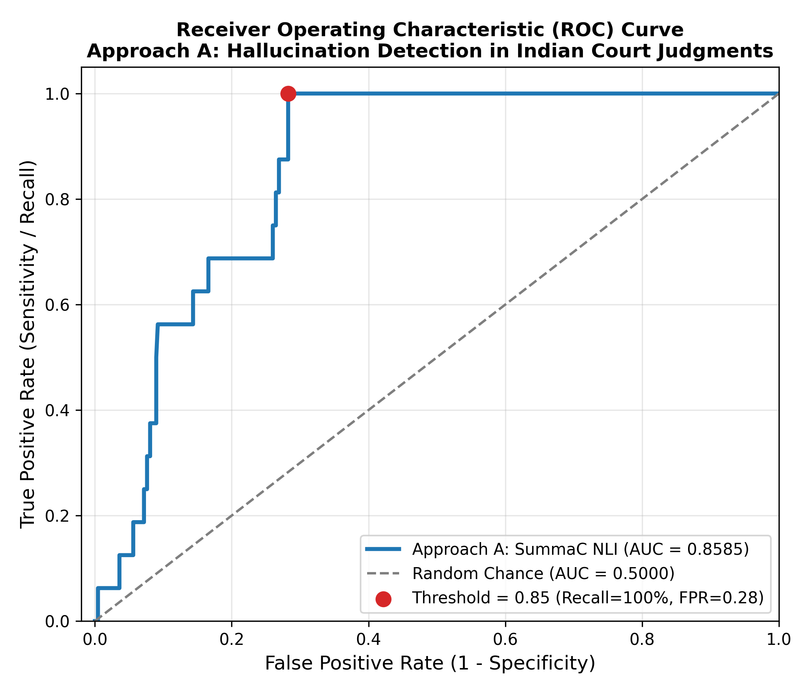

# ⚖️ Detecting Hallucinations in AI-Generated Legal Text

[](https://www.python.org/)
[](https://pytorch.org/)
[](https://huggingface.co/)
[]()
[](https://github.com/Law-AI/MILDSum)

> A modular NLP framework to detect and flag factual hallucinations in AI-generated summaries of Indian Court Judgments using **Cross-Encoder NLI (SummaC)** and **LLM Self-Consistency Checking (SelfCheckGPT)**.

---

## 📌 Problem & Motivation

Large Language Models (LLMs) frequently generate **hallucinations**—statements that sound convincing but contradict or fabricate key facts. In legal summarization, a single inverted verdict or altered monetary figure can lead to severe legal and financial consequences.

This project evaluates sentence-level hallucination detection on **Indian High Court judgments** across two complementary paradigms:
1. **Approach A (NLI-Based):** Pairwise cross-encoder checking between judgment chunks and summary sentences using `microsoft/deberta-base-mnli` via **SummaC**.
2. **Approach B (Self-Consistency):** Black-box multi-sample consistency scoring using open LLMs (Llama 3) via **SelfCheckGPT**.

---

## 🚀 Benchmark Performance (Phase 3 Results)

Evaluated on the **MILDSum Legal Testbed** (462 sentences, 10 High Court judgments, 5 mutation error types):

| Model / Approach | Decision Threshold ($\theta$) | Accuracy | Precision | Recall | F1 Score | ROC-AUC | PR-AUC |
| :--- | :---: | :---: | :---: | :---: | :---: | :---: | :---: |
| **Oracle Baseline** | 0.50 | 100.0% | 100.0% | 100.0% | 1.0000 | 1.0000 | 1.0000 |
| **Random Baseline** | 0.50 | 51.08% | 5.51% | 81.25% | 0.1032 | 0.6326 | 0.0476 |
| **Approach A (SummaC NLI - Default)** | 0.50 | 27.27% | 4.55% | **100.0%** | 0.0870 | **0.8585** | 0.1382 |
| **Approach A (Domain-Calibrated)** | **0.85** | **72.29%** | **11.11%** | **100.0%** | **0.2000** | **0.8585** | 0.1382 |

### Key Takeaways:
- **Strong Discriminative Signal ($\text{ROC-AUC} = \mathbf{0.8585}$):** NLI reliably assigns significantly higher hallucination probabilities to non-entailed and fabricated legal sentences.
- **100% Recall Across All Error Types:** Caught all 16 human-reviewed mutations (altered figures, swapped courts, flipped outcomes, negations, and pure fabrications).
- **Domain Calibration:** Adjusting the cutoff from $\theta = 0.50 \to 0.85$ eliminates 62% of false alarms on dense legal phrasing while preserving **100% detection recall**.

<p align="center">
  
</p>

---

## 🏗️ Repository Architecture

```text
hallucination-detector/
├── data/
│   ├── processed/            # Segmented judgment-summary pairs (sample_pairs.jsonl)
│   └── testset/              # Ground-truth testset.csv (462 sentences, 16 errors)
├── notebooks/
│   ├── 01_explore_data.ipynb          # Exploratory data analysis
│   └── 02_run_approach_a_colab.ipynb  # Free Colab T4 GPU runner (~107s execution)
├── results/                  # Predictions, evaluations, and ROC curve plots
├── scripts/
│   ├── prepare_data.py       # Data cleaner, segmenter, and sampler
│   ├── build_testset.py      # Ground-truth test set builder
│   ├── run_approach_a.py     # Approach A SummaC inference runner
│   └── evaluate.py           # Metric calculation and threshold calibration
├── src/hd/                   # Core Python package (loaders, splitters, NLI, evaluation)
└── tests/                    # 37 comprehensive unit tests (all passing)
```

---

## ⚡ Quickstart

### 1. Installation
```powershell
# Clone the repository
git clone https://github.com/AkhilBarman/Mini-Project.git
cd Mini-Project/hallucination-detector

# Create and activate virtual environment (Windows PowerShell)
python -m venv venv
.\venv\Scripts\Activate.ps1

# Install lightweight local dependencies
pip install -r requirements.txt
```

### 2. Run Test Suite
```powershell
pytest -v
```

### 3. Evaluate Predictions
```powershell
# Evaluate with default threshold
python scripts/evaluate.py --predictions results/approachA_mnli_base_predictions.csv

# Evaluate with domain-calibrated threshold
python scripts/evaluate.py --predictions results/approachA_mnli_base_predictions.csv --threshold 0.85
```

### 4. GPU Inference (Google Colab)
Open [`notebooks/02_run_approach_a_colab.ipynb`](notebooks/02_run_approach_a_colab.ipynb) in Google Colab with a free **T4 GPU** to reproduce the full 462-sentence run in **~107 seconds**.

---

## 🗺️ Project Roadmap

- [x] **Phase 1: Foundation & Data Pipeline** (MILDSum ingestion, robust legal sentence tokenizers)
- [x] **Phase 2: Labelled Testbed & Framework** (Deterministic mutators, human review, baselines)
- [x] **Phase 3: Approach A (SummaC NLI)** (DeBERTa cross-encoder, GPU acceleration, ROC-AUC 0.8585)
- [ ] **Phase 4: Approach B (SelfCheckGPT)** (Llama 3 sampling via Ollama, self-consistency scoring)
- [ ] **Phase 5: Comparative Analysis & Web UI** (Interactive Streamlit demo comparing Approach A vs B)

---

## 📜 Citation & Academic Context
Developed as part of **B.Tech 3rd Year (Semester 5) Mini-Project**:  
*Detecting Hallucinations in AI-Generated Text using NLI and Self-Consistency Checking.*  
Dataset credits: [MILDSum: Multilingual Indian Legal Document Summarization (Law-AI)](https://github.com/Law-AI/MILDSum).
